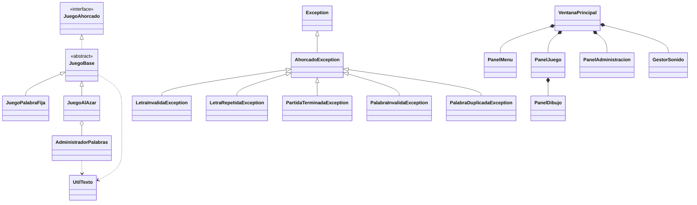

# Laboratorio-4

### Integrantes
- Jorge Mario Chinchilla Sagastume - 22611259
- Kendrick Joad Gutierrez Maldonado - 22611069
- Sergio David Pineda Mendoza - 22611269

### Reglas de validación

- No se distinguen mayúsculas de minúsculas: todo se pasa a mayúsculas.
- Se ignoran las tildes: Á es igual a A, y Ü es igual a U.
- La Ñ es una letra distinta de la N.
- Las letras válidas son de la A a la Z, más la Ñ.
- Una palabra es válida si tiene entre 3 y 15 letras, sin espacios, números ni símbolos.
- Cada clase lleva su propio serialVersionUID, porque este campo no se hereda.
- AdministradorPalabras es serializable porque JuegoAlAzar` lo usa como atributo.
- No declaramos el Random como transient porque Random ya es serializable. Si fuera
  transient, quedaría en null al deserializar el objeto.
- AhorcadoException es abstracta, porque nunca se lanza directamente. Solo sirve como
  clase padre de las demás.
- LetraRepetidaException guarda la letra repetida y la devuelve con getLetra().
- JuegoAhorcado: interfaz que establece los métodos principales que debe implementar el juego.
JuegoBase: clase abstracta que contiene la lógica general, como el registro de letras, los intentos restantes, la palabra oculta y el estado de la partida.
- JuegoPalabraFija: clase que permite iniciar una partida utilizando una palabra establecida manualmente.
- JuegoAlAzar: clase que permite iniciar partidas seleccionando palabras aleatoriamente mediante AdministradorPalabras.
- EstadoPartida: enum que representa si la partida está en curso, ganada o perdida.
- ResultadoLetra: enum que indica si una letra ingresada fue un acierto o un error.
- Modalidad: enum que identifica el tipo de partida.
- EtapaAhorcado: enum que representa las etapas del dibujo del ahorcado.
### Uso de Serializable

Serializable es una interfaz marcadora: no tiene métodos, solo indica que los objetos
de la clase se pueden convertir a bytes. No guardamos archivos; la declaramos porque
el diseño lo pide.

- Cada clase lleva su propio serialVersionUID, porque este campo no se hereda.
- AdministradorPalabras es serializable porque JuegoAlAzar lo usa como atributo.
- No declaramos el Random como transient porque Random ya es serializable.

### Diagrama de clases

